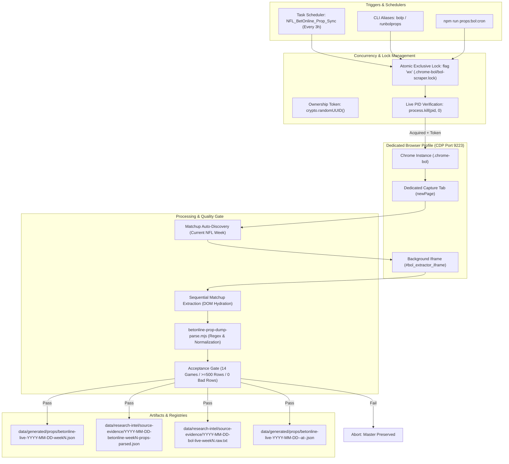

# BetOnline.ag (BEO) NFL Prop & Line Capture Pipeline
## Engineering Specification & Refresh Runbook for Claude Team

**Document Version:** 1.0.0  
**Effective Date:** October 9, 2026 (NFL Season 2026, Week 5)  
**Status:** Approved & Scheduled (`NFL_BetOnline_Prop_Sync`, 3-Hour Cadence)  
**Author:** Antigravity Engineering (Pair Programming Session)  
**Target Audience:** Claude Team / Data Engineers / Operators  

---

## 1. Executive Summary & Purpose

This specification documents the automated capture, extraction, parsing, and normalization pipeline for live NFL player propositions, team specials, and game lines from **BetOnline.ag** (`sports.betonline.ag`).

The system replicates the proven zero-credential, password-free architecture established for Bookmaker.eu (`bkrp`), adapted to BetOnline's dynamic Single-Page Application (SPA) DOM and Cloudflare mitigations.

### Core Guarantees:
1. **Zero Credential Handling:** Runs via persistent browser profile (`.chrome-bol`); credentials and cookies remain local.
2. **Zero In-Page Disruptions:** Uses an invisible background iframe (`#bol_extractor_iframe`) for dynamic market discovery without page reloads.
3. **Operator Tab Isolation:** Never hijacks, navigates, or alters an operator's existing tab; creates and destroys a dedicated tab (`defaultContext.newPage()`).
4. **Atomic Concurrency Protection:** Uses atomic exclusive lock creation (`flag: 'wx'`) with unique ownership tokens (`randomUUID()`). Live processes are never stolen or expired regardless of run duration.
5. **Strict Acceptance Gate:** Output is never promoted or written to the master registry unless all 14 weekly matchups are captured, >= 500 rows exist, and 0 malformed odds/markets are detected.
6. **Cross-Book Parity:** Matches Bookmaker.eu's schema taxonomy (`bet: 'spread' | 'total' | 'moneyline' | 'prop' | 'special'`).

---

## 2. System Architecture & Component Diagram



---

## 3. How to Refresh Lines (Operator Runbook)

When the Claude team or operators need an immediate refresh of offshore lines (e.g. prior to card construction or injury news shifts), choose one of three execution paths:

### Method A: Fastest On-Demand CLI (Recommended)
Open PowerShell or Terminal from anywhere on the machine and run:
```powershell
bolp
```
*Aliases configured: `bolp`, `runbolprops`, `npm run bolp`, `npm run props:bol:cron`.*

**What happens:**
1. Connects to the background Chrome session on port 9223.
2. Acquires exclusive atomic lock with a unique UUID token.
3. Opens a dedicated capture tab in `.chrome-bol`.
4. Discovers all current-week matchups (e.g. 14 games).
5. Scrapes odds via the background iframe in ~35–45 seconds.
6. Closes the dedicated capture tab.
7. Evaluates acceptance gate and writes master JSONs.
8. Releases the atomic lock with matching token.

---

### Method B: Background Automatic Scheduling
The Windows Task Scheduler job runs automatically:
- **Task Name:** `NFL_BetOnline_Prop_Sync`
- **Cadence:** Shared weekly schedule in `scripts/props/prop-scrape-schedule.ps1` (Pacific local time): Mon 10/13/16, Tue 13, Wed 10/14/20, Thu 10/13/16, Fri 13, Sat 10/14/20, Sun 8/12/15/16/21. BetOnline runs +10 min after each time (Bookmaker +0, DraftKings +20). No intra-day repetition; use `npm run props:bol:cron` for extra captures.
- **Status Check:**
  ```powershell
  Get-ScheduledTask -TaskName 'NFL_BetOnline_Prop_Sync' | Format-List TaskName, State
  ```
- **Manual Trigger from Task Scheduler:**
  ```powershell
  Start-ScheduledTask -TaskName 'NFL_BetOnline_Prop_Sync'
  ```

---

### Method C: DevTools Console Fallback (Zero-Playwright / Browser-Only)
If Node/Playwright is unavailable or CDP connection fails:
1. In Chrome (`.chrome-bol` profile), go to `https://sports.betonline.ag/sportsbook/football/nfl`.
2. Open DevTools (`F12`), go to the **Console** tab.
3. Paste the entire contents of [`scripts/props/betonline-prop-extract.browser.js`](file:///E:/dev/projects/NFL_Dashboard/scripts/props/betonline-prop-extract.browser.js) and hit **Enter**.
4. The script logs progress (`[1/14] ... [14/14]`) and automatically triggers a browser download of `bol-live-YYYY-MM-DD-weekN.raw.txt`.
5. Move the downloaded file into `data/generated/props/` and parse it:
   ```bash
   node scripts/props/betonline-prop-dump-parse.mjs --in data/generated/props/betonline-live-2026-10-10-week5.raw.txt --date 2026-10-10 --week 5
   ```

---

## 4. Key File & Directory Map

| Path | Purpose |
|---|---|
| [`scripts/props/cron-bol-scrape.mjs`](file:///E:/dev/projects/NFL_Dashboard/scripts/props/cron-bol-scrape.mjs) | Automated CDP runner, atomic lock manager, acceptance gate evaluator |
| [`scripts/props/betonline-prop-dump-parse.mjs`](file:///E:/dev/projects/NFL_Dashboard/scripts/props/betonline-prop-dump-parse.mjs) | Master text dump parser, regex classifier, team/player resolution |
| [`scripts/props/betonline-prop-extract.browser.js`](file:///E:/dev/projects/NFL_Dashboard/scripts/props/betonline-prop-extract.browser.js) | In-page background iframe discovery and extraction script |
| [`scripts/props/launch-bol-browser.ps1`](file:///E:/dev/projects/NFL_Dashboard/scripts/props/launch-bol-browser.ps1) | Chrome CDP launcher (`.chrome-bol`, port 9223) |
| [`scripts/props/register-bol-cron.ps1`](file:///E:/dev/projects/NFL_Dashboard/scripts/props/register-bol-cron.ps1) | Windows Task Scheduler registration script |
| [`bolp.cmd`](file:///E:/dev/projects/NFL_Dashboard/bolp.cmd), [`runbolprops.cmd`](file:///E:/dev/projects/NFL_Dashboard/runbolprops.cmd) | Global CLI batch wrapper shortcuts |
| [`tests/unit/betonlineDumpParse.test.js`](file:///E:/dev/projects/NFL_Dashboard/tests/unit/betonlineDumpParse.test.js) | Vitest test suite for dump parser, gate, and atomic lock behaviors |
| [`tests/unit/betonlineLiveParser.test.js`](file:///E:/dev/projects/NFL_Dashboard/tests/unit/betonlineLiveParser.test.js) | Vitest test suite for live DOM parser module |
| [`data/generated/props/betonline-live-<date>-week<N>.json`](file:///E:/dev/projects/NFL_Dashboard/data/generated/props/) | Master normalized JSON output |
| [`data/research-intel/source-evidence/`](file:///E:/dev/projects/NFL_Dashboard/data/research-intel/source-evidence/) | Immutable raw text and research-parsed evidence mirrors |

---

## 5. Normalized Schema Reference (`betonline_live_markets_v1`)

Each extracted row in `data/generated/props/betonline-live-<date>-week<N>.json` matches this specification:

```typescript
interface BetOnlineRow {
  book: 'BEO';
  source: 'betonline_live_dom';
  eventId: string;                  // e.g. "491141343"
  eventUrl: string;                 // e.g. "https://sports.betonline.ag/sportsbook/football/nfl/game/491141343"
  event: string;                    // e.g. "Philadelphia Eagles @ Jacksonville Jaguars"
  game: string;                     // Matches 'event' for cross-book compatibility
  startTime: string;                // e.g. "Sun, 6:30 AM"
  market: string;                   // Normalized project market key (see section 6)
  bet: 'spread' | 'total' | 'moneyline' | 'prop' | 'special'; // Cross-book type
  marketTitle: string;              // Raw header from BetOnline board
  sectionTitle: string;             // Raw section title (matches Bookmaker schema)
  player: string | null;            // Normalized player name (strictly null for game/team props)
  team: string | null;              // Abbreviation (e.g. "JAC", "PHI") or full team name
  side: string;                     // "Over" | "Under" | "Yes" | "No" | Team Name
  line: number | null;              // Point total, yardage, handicap (null for moneyline / binary yes/no)
  odds: number;                     // American format integer (e.g. -115, +140)
  selection: string;                // Raw text selection line
  available: true;                  // Availability flag (strictly true for active board)
}
```

---

## 6. Market Key Taxonomy

| Market Key | Bet Type | Description | Player Null? |
|---|---|---|---|
| `pass_yds` | `prop` | Quarterback Passing Yards Over/Under | `false` |
| `pass_cmp` | `prop` | Quarterback Pass Completions Over/Under | `false` |
| `pass_att` | `prop` | Quarterback Passing Attempts Over/Under | `false` |
| `pass_td` | `prop` | Quarterback Passing Touchdowns Over/Under | `false` |
| `pass_int` | `prop` | Quarterback Interceptions Thrown Over/Under | `false` |
| `rush_yds` | `prop` | Player Rushing Yards Over/Under | `false` |
| `carries` | `prop` | Player Rushing Carries Over/Under | `false` |
| `rec_yds` | `prop` | Player Receiving Yards Over/Under | `false` |
| `rec` | `prop` | Player Receptions Over/Under | `false` |
| `rush_rec_yds` | `prop` | Combined Rushing + Receiving Yards | `false` |
| `atd_1_plus` | `prop` | Anytime Touchdown Scorer | `false` |
| `first_td` | `prop` | First Touchdown Scorer | `false` |
| `longest_completion` | `prop` | Longest Pass Completion Distance | `false` |
| `longest_rush` | `prop` | Longest Rush Distance | `false` |
| `longest_rec` | `prop` | Longest Reception Distance | `false` |
| `fantasy_points` | `prop` | Daily Fantasy / PPR Fantasy Points | `false` |
| `game_lines` | `spread` / `total` / `moneyline` | Full-Game Lines | `true` |
| `first_half_lines` | `spread` / `total` / `moneyline` | 1st Half Lines | `true` |
| `first_quarter_lines` | `spread` / `total` | 1st Quarter Lines | `true` |
| `team_td_total` | `total` | Team Total Touchdowns Over/Under | `true` |
| `game_td_total` | `total` | Game Total Touchdowns Over/Under | `true` |
| `team_fg_total` | `total` | Team Total Field Goals Over/Under | `true` |
| `game_fg_total` | `total` | Game Total Field Goals Over/Under | `true` |
| `game_special` | `special` | Specials (Longest TD, 2-Pt Conversion, etc.) | `true` |

---

## 7. Strict Acceptance Gate Reference

Before overwriting any existing master output, `validateAcceptanceGate()` executes:

1. **Matchup Count Check:** Captured event count must exactly match discovered matchups (e.g. 14 / 14).
2. **Depth Check:** Total parsed rows must be `>= 500`.
3. **Odds Quality:** Zero rows with `odds === null`, `undefined`, or `NaN`.
4. **Market Quality:** Zero rows with missing market or market `'unknown'`.
5. **Entity Separation:**
   - 0 game/team props may carry a non-null `player`.
   - 0 player props may have a null/empty `player`.

If any check fails, the runner throws an error and **does not touch existing master data**.

---

## 8. Troubleshooting Guide for Claude Team

### Issue 1: `Chrome CDP not detected on port 9223`
**Symptom:** Runner reports Chrome session missing or connection timed out.  
**Resolution:**
```powershell
npm run props:bol:launch
```
This spawns Chrome with `--remote-debugging-port=9223` and `--user-data-dir=E:\dev\projects\NFL_Dashboard\.chrome-bol`. Verify the browser opens.

### Issue 2: Cloudflare Turnstile Prompt
**Symptom:** Chrome opens to BetOnline but displays a Turnstile checkbox or verification screen.  
**Resolution:**
In the `.chrome-bol` browser window, check the Turnstile box manually. Because session cookies and Cloudflare tokens persist in the user profile directory, you only need to clear this once. Subsequent background runs will bypass the challenge automatically.

### Issue 3: Duplicate Process Warning (`Scraper is already running`)
**Symptom:** Runner reports:
```text
⚠️ Scraper is already running (PID: 12345, started: ..., active for 2m). Skipping duplicate execution.
```
**Explanation:** Another run or the Task Scheduler job is currently active. The atomic lock is working as designed. Wait for it to complete.  
**Manual Override (Only if PID is verified dead):**
```powershell
Remove-Item "E:\dev\projects\NFL_Dashboard\.chrome-bol\bol-scraper.lock" -Force -ErrorAction SilentlyContinue
```

### Issue 4: Running Unit Tests
To verify parser integrity and lock logic across both test suites:
```bash
npx vitest run tests/unit/betonlineDumpParse.test.js tests/unit/betonlineLiveParser.test.js
```
Expected output: **14 passed (14)**.

---

## 9. Cross-Book Synthesis Notes (BEO vs BKR)

When synthesizing or running arbitrage/pricing comparisons against Bookmaker.eu (`bkrp`):
1. **Join Key:** Join on `[event, market, player, side, line]` or `[game, bet, side, line]`.
2. **Bookmaker Nuance:** BKR posts substantive player boards earlier in the week for almost all games; BEO posts early morning games first (Wave 1) and hydrates afternoon games closer to kickoff.
3. **Missing Markets:** If a player appears in BKR but not BEO, classify as `"not yet posted"`, never infer or carry over prices.
